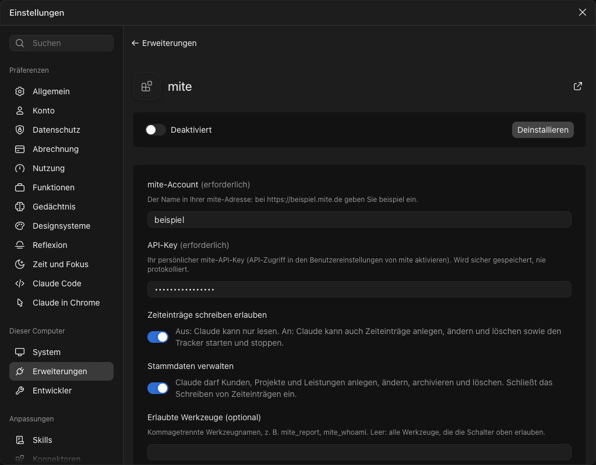

# mite-mcp-server

[](https://github.com/Stefan39/mite-mcp-server/actions/workflows/ci.yml)
[](LICENSE)

**English** · [Deutsch](README.de.md)

Ask Claude about your [mite](https://mite.de) time tracking — "How many hours did we spend on each project per month this year, and what did that earn?" — and get the answer from a report mite computes itself, not from hundreds of entries the model has to add up.

> Unofficial. Not affiliated with or endorsed by mite GmbH.

## Why this server

- **Ready-made reports.** mite groups on the server (`group_by`), so a whole year is one request and one small answer.
- **Safe by default.** Starts read-only. Write tools only exist when you switch the mode on, and an allowlist narrows it further. Tools outside mode and allowlist are not even shown to the agent.
- **Your key stays yours.** API key from the environment only, sent as header, removed from every error message, never logged.

## Tools

| Tool                                                                 | Mode      | What it does                                                                                                                       |
| -------------------------------------------------------------------- | --------- | ---------------------------------------------------------------------------------------------------------------------------------- |
| `mite_whoami`                                                        | read-only | Account, your user and role, server mode and enabled tools                                                                         |
| `mite_report_projects_by_month`                                      | read-only | Hours and revenue per project and month for a period; filters for customer, project, service, user, billable                       |
| `mite_report`                                                        | read-only | Hours, revenue and share per 1–3 groupings (customer, project, service, user, day, week, month, year); same filters                |
| `mite_report_budget`                                                 | read-only | Budget, consumption, remaining and percent used per project over its whole life; minutes in hours, cents in currency units         |
| `mite_report_billable_ratio`                                         | read-only | Billable and non-billable hours and billable share in percent for a period, optionally per customer, project, user or month        |
| `mite_list_time_entries`                                             | read-only | Single time entries for a period, newest first; filters, `limit`/`page`, `has_more`                                                |
| `mite_get_time_entry`                                                | read-only | One time entry by id                                                                                                               |
| `mite_tracker_status`                                                | read-only | Whether the tracker is running, and on which entry                                                                                 |
| `mite_list_customers`                                                | read-only | Customers, active or archived (`archived: true`)                                                                                   |
| `mite_list_projects`                                                 | read-only | Projects with customer and budget, active or archived                                                                              |
| `mite_list_services`                                                 | read-only | Services, active or archived                                                                                                       |
| `mite_list_users`                                                    | read-only | Users and roles (no email, no rates), active or archived                                                                           |
| `mite_create_time_entry`                                             | write     | Creates a time entry; `dry_run: true` shows a preview and writes nothing                                                           |
| `mite_update_time_entry`                                             | write     | Changes fields of a time entry (locked ones: see below); `dry_run: true` shows current vs. new values and writes nothing           |
| `mite_start_tracker`                                                 | write     | Starts the tracker on a time entry                                                                                                 |
| `mite_stop_tracker`                                                  | write     | Stops the tracker on a time entry                                                                                                  |
| `mite_delete_time_entry`                                             | write     | Deletes a time entry in two steps with a confirmation token (see below); locked entries: see "Locked entries"                      |
| `mite_create_customer`, `mite_create_project`, `mite_create_service` | admin     | Creates a customer, project or service; `dry_run: true` shows a preview and writes nothing                                         |
| `mite_update_customer`, `mite_update_project`, `mite_update_service` | admin     | Changes fields; `archived: true` archives, `archived: false` restores; `dry_run: true` writes nothing                              |
| `mite_delete_customer`, `mite_delete_project`, `mite_delete_service` | admin     | Deletes in two steps with a confirmation token (see below); mite's refusal, e.g. while time entries exist, is returned as an error |

### Deleting with a confirmation token

`mite_delete_time_entry` and the three master data delete tools never delete on the first call:

1. Call it with the `id` (or with `dry_run: true`). It returns a preview of the entry and a `confirm_token`; nothing is deleted.
2. Call it again with the same `id` and the `confirm_token`. Only then is it deleted.

The token is bound to the tool and its arguments, valid for 5 minutes, usable once, and only known to the running server process (a restart invalidates it).

If the MCP client supports elicitation, the second call (and any call with `force: true` and a token) additionally asks the human with a short summary of what will be deleted or forced. Only if the human accepts is anything executed. If they decline or cancel, nothing is sent to mite and the token stays unused until it expires. Clients without elicitation are not asked; the token alone applies.

> **Client support (checked 28.10.2026):** Claude Desktop does not offer elicitation yet, so it shows no dialog; deleting there uses the token flow only. Once a client announces elicitation, the extra question applies without a new release of this server.

### Locked entries

Locked time entries cannot be changed or deleted by default; mite answers with 423 and the tool returns a "locked" error. `force` is never set automatically, not even after a 423.

In mode `admin` only, `mite_update_time_entry` and `mite_delete_time_entry` additionally accept `force: true`. A call with `force: true` always needs a `confirm_token`, also on update: the first call (or `dry_run: true`) returns a preview stating that the entry is locked, plus a token; only a second call with the same arguments, `force: true` and the token executes. In modes `read-only` and `write` the parameter is not part of the input schema.

More tools (more reports) are planned — see [the architecture decision](docs/adr/0001-architecture.md).

## Install without technical knowledge (Claude Desktop)

1. Download [`mite-mcp-server.mcpb`](https://github.com/Stefan39/mite-mcp-server/releases/latest/download/mite-mcp-server.mcpb) from the latest release.
2. Double-click the file. Claude Desktop opens and offers to install the extension.
3. Fill in the settings and enable the extension:



| Setting                         | Meaning                                                                                          |
| ------------------------------- | ------------------------------------------------------------------------------------------------ |
| mite-Account                    | The name in your mite address: for `https://example.mite.de` enter `example`                     |
| API-Key                         | Your personal mite API key; Claude Desktop stores it securely and shows it masked                |
| Zeiteinträge schreiben erlauben | Off (default): read only. On: create, change and delete time entries, start and stop the tracker |
| Stammdaten verwalten            | Off (default). On: manage customers, projects and services; includes writing time entries        |
| Erlaubte Werkzeuge              | Optional, comma-separated tool names; empty means every tool the switches allow                  |

No JSON, no environment variables, no Node.js installation: Claude Desktop runs the bundle with its built-in Node.js. You need a mite account with API access enabled (in your mite user settings) and your API key from there. The settings are in German because mite's users mostly are.

Changing a setting later: Claude Desktop → Settings → Extensions → mite. **A changed setting only takes effect after you switch the extension off and on again or restart Claude Desktop** — until then the running server keeps the old switches. Ask Claude to call `mite_whoami` to see the mode the server is actually running in. In the same place you can also switch single tools on and off — on top of the switches above, which decide which tools exist at all.

## Manual setup (Claude Desktop, for developers)

Requirements: Node.js 22 or newer, a mite account with API access enabled (enable it in your mite user settings), and your API key from there.

> The package is not published on npm yet. Until it is, build it from source:
>
> ```bash
> git clone https://github.com/Stefan39/mite-mcp-server.git
> cd mite-mcp-server && npm ci && npm run build
> ```

Add the server to `claude_desktop_config.json` (macOS: `~/Library/Application Support/Claude/`), then restart Claude Desktop:

```json
{
  "mcpServers": {
    "mite": {
      "command": "node",
      "args": ["/absolute/path/to/mite-mcp-server/dist/index.js"],
      "env": {
        "MITE_ACCOUNT": "your-account",
        "MITE_API_KEY": "your-api-key"
      }
    }
  }
}
```

Then ask, for example: _"Show me hours and revenue per project and month for this year."_

## Configuration

| Variable           | Required | Meaning                                                                     |
| ------------------ | -------- | --------------------------------------------------------------------------- |
| `MITE_ACCOUNT`     | yes      | Account name — the subdomain of `https://<account>.mite.de`                 |
| `MITE_API_KEY`     | yes      | Your personal mite API key                                                  |
| `MITE_MODE`        | no       | `read-only` (default), `write` or `admin`                                   |
| `MITE_ALLOW_WRITE` | no       | `true` = mode `write`; set by the bundle switch, alternative to `MITE_MODE` |
| `MITE_ALLOW_ADMIN` | no       | `true` = mode `admin`; set by the bundle switch, alternative to `MITE_MODE` |
| `MITE_TOOLS`       | no       | Comma-separated allowlist, e.g. `mite_report_projects_by_month`             |

Use either `MITE_MODE` or the two switches; the server refuses `MITE_MODE` together with a switch set to `true`. Values `true`/`false` (also `1`/`0`, `yes`/`no`, `on`/`off`).

mite still checks every call against the role of your key. The server can only restrict that, never extend it.

## Development

```bash
npm ci
npm run check   # lint, format, typecheck, tests with coverage, build
```

See [CONTRIBUTING.md](CONTRIBUTING.md) and the [architecture decision](docs/adr/0001-architecture.md).

## License

[MIT](LICENSE) © Stefan Jacomeit — [www.jacomeit.de](https://www.jacomeit.de)
